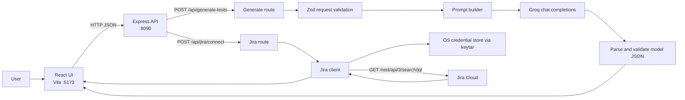

# Architecture and Workflow

## Purpose

This repository contains a browser application that turns user-story details into structured test cases with Groq and can fetch Jira issues for a configured project. The frontend never connects directly to Groq or Jira; all provider calls are made by the backend.

## System Context



## Repository Layout

| Path | Responsibility |
| --- | --- |
| `frontend/src/main.tsx` | Mounts the React application. |
| `frontend/src/App.tsx` | Owns form, generated-result, loading/error, reset, and Jira-connection UI state. |
| `frontend/src/api.ts` | Sends typed JSON requests to the backend API. |
| `frontend/src/types.ts` | Frontend request and response contracts. |
| `frontend/.env` | Public Vite API URL only; values prefixed `VITE_` are bundled into the browser. |
| `backend/src/server.ts` | Loads the workspace-root `.env`, configures Express/CORS/body parsing, exposes health check, and mounts API routes. |
| `backend/src/routes/generate.ts` | Validates generation input, invokes prompt and Groq services, validates model output, and returns JSON. |
| `backend/src/schemas.ts` | Zod request, test-case, and response schemas. |
| `backend/src/prompt.ts` | Defines system instructions and builds the user-story prompt. |
| `backend/src/llm/groqClient.ts` | Calls the Groq OpenAI-compatible chat-completions API. |
| `backend/src/routes/jira.ts` | Handles `POST /api/jira/connect` and returns connection state and issues. |
| `backend/src/jiraClient.ts` | Reads Jira metadata from the backend environment, retrieves the token, calls Jira search, and maps issues to UI data. |
| `backend/src/jiraCredentialStore.ts` | Reads/writes the Jira token through `keytar` using a stable service/account name. |
| `backend/scripts/storeJiraToken.ts` | Interactively reads a token without echoing it, then saves it to the OS credential store. |
| `.env.example` | Safe template for backend configuration; contains placeholders, not usable credentials. |
| `.gitignore` | Excludes `.env` variants, dependencies, build outputs, and local artifacts. |

## Request Workflows

### Generate Test Cases

1. The user enters Story Title, Summary, and Acceptance Criteria. Description and Additional Info are optional. The UI requires the first three values.
2. `App.tsx` submits the typed request through `frontend/src/api.ts` to `POST /api/generate-tests`.
3. Express validates the request using `GenerateRequestSchema`.
4. `buildPrompt` combines the fields with the system prompt, and `GroqClient` calls the configured Groq model.
5. The route parses the model response as JSON and validates it against `GenerateResponseSchema`.
6. The frontend renders test cases, including expandable details, model information, and token usage when available.

Request failures are reported as HTTP 400 for invalid input, HTTP 502 for provider/model failures, and HTTP 500 for unexpected route errors.

### Connect to Jira

1. The user selects **Connect JIRA**. The browser calls `POST /api/jira/connect`; it sends no Jira credentials.
2. The backend validates `JIRA_BASE_URL`, `JIRA_EMAIL`, and `JIRA_PROJECT_KEY` from the workspace-root `.env`.
3. `JiraClient` reads the API token from the OS credential store using `keytar` (`service`: `user-story-to-tests`; `account`: `jira-api-token`).
4. The backend sends a Basic-authenticated `GET /rest/api/3/search/jql` request with JQL ordered by creation date and requests up to 50 issues.
5. Jira issues are mapped to `id`, `key`, `summary`, `status`, `issueType`, and URL fields, then returned to the UI.
6. The UI displays the connected state and issue list, or an error state if the request fails.

The token is not read from `.env`, sent to the browser, or included in the Jira client’s log output. Re-running the setup command updates the same credential-store entry.

### Reset the UI

The **Reset** button clears the form, generated results, errors, Jira connection display, expanded test cases, and loading state. It does not delete environment settings or the stored Jira token.

## Configuration and Secret Boundaries

- The workspace-root `.env` is loaded by the backend. Configure `PORT`, `CORS_ORIGIN`, `groq_API_BASE`, `groq_API_KEY`, `groq_MODEL`, `JIRA_BASE_URL`, `JIRA_EMAIL`, and `JIRA_PROJECT_KEY` there.
- `JIRA_API_TOKEN` is intentionally absent from `.env` and `.env.example`. Store it with `npm run setup:jira-token --workspace backend` from an interactive terminal.
- On Windows, `keytar` stores the token in Windows Credential Manager. On other supported platforms, it uses the platform credential store.
- `frontend/.env` contains only `VITE_API_BASE_URL`. Never put Groq or Jira credentials in frontend configuration: Vite exposes `VITE_*` values to browser code.
- Keep the real root `.env` local and untracked. `.gitignore` excludes `.env` files.
- If a token has been exposed in chat, source control, screenshots, or logs, revoke it with the provider and store a new token.

## Runtime and API Surface

| Method | Path | Purpose |
| --- | --- | --- |
| `GET` | `/api/health` | Backend health status. |
| `POST` | `/api/generate-tests` | Validate a story and generate test cases. |
| `POST` | `/api/jira/connect` | Authenticate to Jira and fetch project issues. |

The root `npm run dev` command starts backend and frontend concurrently. The backend defaults to port `8090` from the supplied configuration; Vite serves the frontend on port `5173`. The frontend API URL must point to the backend API base, normally `http://localhost:8090/api`.

Useful checks:

```powershell
npm run typecheck
Invoke-RestMethod http://localhost:8090/api/health
```